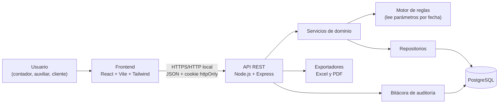
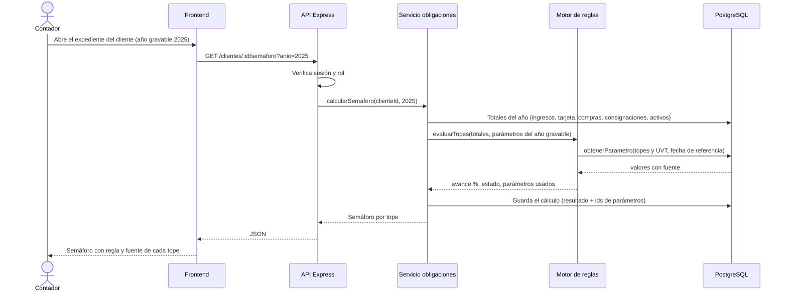

# Arquitectura

> Versión 0.1 · 17-oct-2026 · Estado: borrador. Depende de `01-analisis/` (requisitos RF/RNF y reglas RN).

## 1. Visión general

Aplicación web de tres capas, pensada para funcionar **localmente en Windows** (RNF-06) con el stack que ya domina el autor: React + Vite + Tailwind, Node.js/Express y PostgreSQL.



## 2. Capas y responsabilidades

| Capa | Responsabilidad | No debe hacer |
|---|---|---|
| **Frontend** | Pantallas, formularios, mostrar semáforos y borradores | Calcular reglas tributarias ni decidir permisos |
| **Rutas y controladores** | Recibir la petición, validar entradas, llamar al servicio | Contener lógica de negocio ni SQL |
| **Middlewares** | Autenticación, autorización por rol, límite de intentos, CSRF, manejo de errores | Conocer reglas contables |
| **Servicios de dominio** | Casos de uso: registrar movimiento, calcular semáforo, activar año, liquidar nómina | Acceder a `req`/`res` |
| **Motor de reglas** | Evaluar topes y fórmulas usando **parámetros vigentes en la fecha del hecho** (RN-01, RNF-08) | Tener cifras escritas en el código |
| **Repositorios** | Todo el SQL, con consultas parametrizadas | Tomar decisiones de negocio |
| **PostgreSQL** | Persistencia, integridad (claves, restricciones, vigencias sin solapamiento) | — |

## 3. Estructura prevista del código

```
backend/
├── src/
│   ├── app.js
│   ├── config/            (variables de entorno, conexión a BD)
│   ├── middlewares/       (auth, roles, csrf, errores, rate-limit)
│   ├── modules/
│   │   ├── auth/
│   │   ├── clientes/
│   │   ├── movimientos/
│   │   ├── parametros/     (incluye "actualizar año")
│   │   ├── obligaciones/   (semáforo, GMF, calendario)
│   │   ├── renta/
│   │   ├── exogena/
│   │   ├── nomina/
│   │   └── auditoria/
│   │       cada módulo: routes · controller · service · repository · schema
│   ├── rules/              (motor de reglas y funciones puras de cálculo)
│   └── exports/            (Excel y PDF)
├── tests/
frontend/
├── src/
│   ├── pages/ · components/ · hooks/ · services/ (cliente de API) · routes/
database/
├── schema.sql · seed-demo.sql · migrations/
```

## 4. Motor de reglas parametrizado

Es la pieza que cumple el principio "ninguna cifra en el código" (RNF-08).

- Una función `obtenerParametro(codigo, fecha)` devuelve el valor activo en esa fecha, con su fuente y su `id`.
- Las reglas son **funciones puras**: reciben datos y parámetros, devuelven un resultado. Así se prueban fácilmente con casos calculados a mano.
- Cada resultado guarda los `id` de los parámetros usados (RN-04). Así un cálculo puede reproducirse y explicarse meses después.

Ejemplo de consulta de un parámetro vigente:

```sql
SELECT id, valor, unidad, operador, fuente_norma, fuente_url, nivel_verificacion
FROM parametros
WHERE codigo = $1
  AND estado = 'activo'
  AND vigente_desde <= $2
  AND (vigente_hasta IS NULL OR vigente_hasta >= $2);
```

## 5. Flujo: calcular el semáforo de renta de un cliente



## 6. Flujo: activar el año nuevo (resumen)

1. El contador crea el conjunto del año siguiente en estado `borrador`, copiado del anterior.
2. Carga o corrige parámetros; cada uno exige fuente.
3. Pasa el conjunto a `en_revision` y se genera el reporte de diferencias.
4. Un aprobador (distinto de quien cargó, si hay más de un usuario) activa el conjunto.
5. En **una sola transacción**: el conjunto anterior pasa a `historico`, sus parámetros se cierran con `vigente_hasta`, los nuevos pasan a `activo`, y se escribe la bitácora. Si algo falla, no cambia nada.

## 7. Seguridad transversal (resumen)

Detalle en `05-seguridad.md` (pendiente). Principios:

- Contraseñas con hash; sesión en cookie `httpOnly` con protección CSRF.
- Autorización siempre en el backend (RNF-03).
- Campos sensibles (documento, cuentas) cifrados en la aplicación (RNF-02).
- Consultas parametrizadas, sin concatenar SQL.
- Bitácora de auditoría de solo inserción.

## 8. Despliegue local

| Componente | Detalle |
|---|---|
| Sistema | Windows 11 |
| Backend | Node.js, puerto local configurable |
| Base de datos | PostgreSQL local, esquema creado con `database/schema.sql` |
| Frontend | Servido por Vite en desarrollo; compilado y servido por el backend en uso diario |
| Configuración | Variables de entorno en `.env` (nunca en el repositorio) |
| Respaldo | `pg_dump` programado; procedimiento en `05-despliegue/` |

Las versiones exactas de Node.js, PostgreSQL y las librerías se fijarán en la guía de desarrollo al iniciar el código, tomándolas del equipo real del autor. ❓ No se registran aquí hasta confirmarlas.

## 9. Decisiones de arquitectura (ADR)

| ADR | Decisión | Estado |
|---|---|---|
| ADR-001 | Nombres de tablas y columnas en español (`snake_case`), por tratarse de un dominio colombiano; código de aplicación consistente con el repositorio | Propuesta |
| ADR-002 | Base de datos: **PostgreSQL** (decidido el 17-oct-2026; rigidez e integridad para datos contables, sin instalar herramientas nuevas) | Decidida |
| ADR-003 | Las reglas viven en un motor parametrizado con funciones puras, no en los controladores | Propuesta |
| ADR-004 | Dinero con `NUMERIC(18,2)`; nunca `float`. Los topes en UVT se calculan sin redondeo intermedio (RN-03) | Propuesta |
| ADR-005 | Vigencias de parámetros con rangos de fechas y restricción de no solapamiento en la base de datos | Propuesta |
| ADR-006 | Cifrado de campos sensibles en la aplicación con el módulo `crypto` de Node, con la clave en variable de entorno | Propuesta |
| ADR-007 | Biblioteca de exportación a Excel y PDF | Pendiente |
| ADR-008 | Nombre del proyecto: se mantiene ContaNegocios y se cambia, si se desea, al final | Decidida |

## 10. Riesgos técnicos

| Riesgo | Mitigación |
|---|---|
| Un error en el motor de reglas produce una cifra equivocada | Funciones puras con pruebas basadas en casos calculados a mano (RNF-04) |
| La activación del año deja datos a medias | Transacción única y bitácora |
| Pérdida de datos en el equipo local | Respaldo programado y restauración probada |
| Fuga de la clave de cifrado | Clave fuera del repositorio; rotación documentada |
