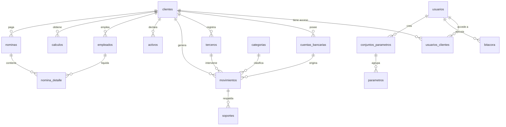

# Modelo de datos

> Versión 0.2 · 17-oct-2026 · Motor: PostgreSQL (ADR-002). Estado: borrador.
> Convenciones: tablas y columnas en `snake_case` y en español (ADR-001); dinero en `NUMERIC(18,2)`; fechas de hechos en `DATE`; marcas de tiempo en `TIMESTAMPTZ`; textos de estado con `TEXT` + `CHECK`.

## 1. Diagrama entidad-relación



La bitácora y los cálculos guardan referencias a otras entidades por `entidad` + `entidad_id` (no por clave foránea), para conservar el registro aunque la entidad cambie.

## 2. Diccionario de tablas

### 2.1 Seguridad

**`usuarios`**
| Columna | Tipo | Notas |
|---|---|---|
| `id` | BIGSERIAL PK | |
| `nombre` | TEXT | |
| `correo` | TEXT UNIQUE | |
| `clave_hash` | TEXT | Hash de la contraseña, nunca la contraseña |
| `rol` | TEXT | `contador`, `auxiliar`, `cliente` |
| `activo` | BOOLEAN | |
| `intentos_fallidos` | INT | Para el bloqueo temporal (HU-01) |
| `bloqueado_hasta` | TIMESTAMPTZ NULL | |

**`usuarios_clientes`**: qué clientes ve cada usuario. PK compuesta (`usuario_id`, `cliente_id`). Un usuario con rol `cliente` queda vinculado a su propio expediente.

### 2.2 Clientes

**`clientes`**
| Columna | Tipo | Notas |
|---|---|---|
| `id` | BIGSERIAL PK | |
| `tipo_persona` | TEXT | `natural` ahora; `juridica` queda prevista (RF-13) |
| `tipo_documento` | TEXT | CC, NIT, etc. |
| `documento_cifrado` | BYTEA | Cifrado en la aplicación (RNF-02) |
| `documento_hash` | TEXT UNIQUE | Hash con clave secreta, para unicidad y búsqueda sin descifrar |
| `ultimos_digitos` | TEXT | Dos últimos dígitos, para el calendario (RN-16) |
| `nombre` | TEXT | |
| `tipo_contribuyente` | TEXT | `asalariado` u `otro` (RN-13, pendiente de validar) |
| `es_empleador` | BOOLEAN | Habilita nómina |
| `activo` | BOOLEAN | |

**`cuentas_bancarias`**: `cliente_id`, `banco`, `numero_cifrado`, `ultimos4`, `marcada_gmf` (BOOLEAN, opcional por RN-33).

**`terceros`**: `cliente_id`, `tipo_documento`, `documento`, `nombre`. Base para exógena.

### 2.3 Movimientos y patrimonio

**`categorias`**
| Columna | Tipo | Notas |
|---|---|---|
| `id` | SERIAL PK | |
| `nombre` | TEXT | |
| `tipo_movimiento` | TEXT | Tipo al que aplica |
| `cedula_renta` | TEXT NULL | `trabajo`, `pensiones`, `capital`, `no_laborales`, `otros` (RN-15) |
| `concepto_exogena` | TEXT NULL | Concepto para el papel de trabajo (pendiente de validar, RN-44) |

**`movimientos`**
| Columna | Tipo | Notas |
|---|---|---|
| `id` | BIGSERIAL PK | |
| `cliente_id` | FK → `clientes` | |
| `fecha` | DATE | Define el año gravable y los parámetros aplicables |
| `anio_gravable` | SMALLINT | Generada a partir de `fecha` |
| `tipo` | TEXT | `ingreso`, `gasto`, `consignacion`, `pago_tarjeta`, `compra`, `gmf` |
| `valor` | NUMERIC(18,2) | `CHECK (valor > 0)` |
| `categoria_id` | FK | |
| `tercero_id` | FK NULL | |
| `cuenta_id` | FK NULL | |
| `descripcion` | TEXT | |
| `creado_por` / `creado_en` | FK / TIMESTAMPTZ | |
| `anulado_en` | TIMESTAMPTZ NULL | Anulación en lugar de borrado (ADR-011) |
| `anulado_por` | FK NULL → `usuarios` | |
| `motivo_anulacion` | TEXT NULL | Obligatorio al anular |

Índices: (`cliente_id`, `anio_gravable`, `tipo`) para los totales del semáforo. Los totales excluyen movimientos con `anulado_en` no nulo.

**`soportes`**: `movimiento_id`, `nombre_archivo`, `ruta`, `hash_archivo`, `subido_por`, `subido_en`.

**`activos`**: `cliente_id`, `anio_gravable`, `descripcion`, `tipo`, `valor_31_dic`. Permite calcular el patrimonio bruto a 31 de diciembre (tope de patrimonio). Las deudas, para patrimonio líquido, se agregarán en una versión posterior.

### 2.4 Parámetros (pieza central)

**`conjuntos_parametros`**: el "paquete" de un año.
| Columna | Tipo | Notas |
|---|---|---|
| `id` | BIGSERIAL PK | |
| `anio` | SMALLINT UNIQUE | |
| `estado` | TEXT | `borrador`, `en_revision`, `activo`, `historico` |
| `creado_por`, `activado_por` | FK → `usuarios` | |
| `activado_en` | TIMESTAMPTZ NULL | |

**`parametros`**
```sql
CREATE TABLE parametros (
  id                 BIGSERIAL PRIMARY KEY,
  conjunto_id        BIGINT REFERENCES conjuntos_parametros(id),
  codigo             TEXT          NOT NULL,   -- p. ej. 'UVT', 'RENTA_TOPE_INGRESOS'
  valor              NUMERIC(18,4) NOT NULL,
  unidad             TEXT          NOT NULL
                     CHECK (unidad IN ('COP','UVT','PORCENTAJE','DIAS')),
  operador           TEXT CHECK (operador IN ('>=','>')),   -- RN-12
  vigente_desde      DATE          NOT NULL,
  vigente_hasta      DATE,                                  -- NULL = sin fin
  fuente_norma       TEXT          NOT NULL,
  fuente_url         TEXT,
  nivel_verificacion TEXT          NOT NULL
                     CHECK (nivel_verificacion IN ('verificado','probable','no_verificado')),
  estado             TEXT          NOT NULL
                     CHECK (estado IN ('borrador','en_revision','activo','historico')),
  creado_por         BIGINT        NOT NULL REFERENCES usuarios(id),
  aprobado_por       BIGINT        REFERENCES usuarios(id),
  aprobado_en        TIMESTAMPTZ,
  CHECK (vigente_hasta IS NULL OR vigente_hasta >= vigente_desde),
  CHECK (estado <> 'activo' OR aprobado_por IS NOT NULL)
);

-- Un mismo código no puede tener dos vigencias activas que se solapen (ADR-005, RN-62).
-- Requiere la extensión btree_gist (viene con los módulos contrib de PostgreSQL).
CREATE EXTENSION IF NOT EXISTS btree_gist;
ALTER TABLE parametros
  ADD CONSTRAINT parametros_sin_solape
  EXCLUDE USING gist (
    codigo WITH =,
    daterange(vigente_desde, vigente_hasta, '[]') WITH &&
  ) WHERE (estado = 'activo');
```

⚠️ Verificar en la instalación real del autor que la extensión `btree_gist` está disponible. Si no lo estuviera, la regla se valida en el servicio y se cubre con pruebas.

La regla "quien carga no aprueba" (RN-61) se aplica en el **servicio**, no como restricción de base de datos, porque con un único usuario no es aplicable.

**`calendario_tributario`**: `anio_gravable`, `obligacion` (`renta`, `exogena`), `digitos_desde`, `digitos_hasta`, `fecha_limite`, `fuente`. Tabla editable (RN-16).

**`exogena_formatos`**: `codigo`, `anio_gravable`, `nombre`, `version`, `estado`.

### 2.5 Nómina

**`empleados`**: `cliente_id`, `tipo_documento`, `documento_cifrado`, `nombre`, `fecha_ingreso`, `fecha_retiro` NULL, `salario_base` NUMERIC(18,2), `activo`.

**`nominas`**: `cliente_id`, `anio`, `mes`, `estado` (`borrador`, `liquidada`, `cerrada`), `liquidada_por`, `liquidada_en`. Única por (`cliente_id`, `anio`, `mes`).

**`nomina_detalle`**: `nomina_id`, `empleado_id`, `salario`, `auxilio_transporte`, `descuento_salud`, `descuento_pension`, `neto`, y los aportes del empleador y provisiones (columnas por confirmar, RN-54). Guarda también los `id` de los parámetros usados.

### 2.6 Trazabilidad

**`calculos`**: resultados reproducibles (semáforo, borrador de renta, exógena).
| Columna | Tipo | Notas |
|---|---|---|
| `id` | BIGSERIAL PK | |
| `cliente_id` | FK | |
| `tipo` | TEXT | `semaforo`, `renta`, `exogena`, `gmf` |
| `anio_gravable` | SMALLINT | |
| `resultado` | JSONB | Valores, porcentajes y estado |
| `parametros_usados` | JSONB | `id` de cada parámetro aplicado (RN-04) |
| `generado_por`, `generado_en` | FK / TIMESTAMPTZ | |

**`bitacora`** (solo inserción): `usuario_id`, `accion`, `entidad`, `entidad_id`, `antes` JSONB, `despues` JSONB, `ip`, `creado_en`. Los permisos de la base de datos para el usuario de la aplicación no incluyen `UPDATE` ni `DELETE` sobre esta tabla.

## 3. Reglas de integridad principales

| Regla | Dónde se garantiza |
|---|---|
| Documento único por cliente | `UNIQUE` sobre `documento_hash` |
| Valores de movimientos positivos | `CHECK (valor > 0)` |
| Un parámetro activo siempre está aprobado | `CHECK` en `parametros` |
| Sin vigencias activas solapadas por código | `EXCLUDE` con `btree_gist` |
| Una nómina por cliente y mes | `UNIQUE (cliente_id, anio, mes)` |
| La bitácora no se edita ni se borra | Permisos de la base de datos |
| Quien carga un parámetro no lo aprueba (con más de un usuario) | Servicio (RN-61) |

## 4. Trazabilidad con requisitos y reglas

| Elemento | Requisitos / reglas |
|---|---|
| `parametros`, `conjuntos_parametros` | RF-30 a RF-36, RN-01, RN-60 a RN-63 |
| `movimientos`, `activos` | RF-20, RF-21, RF-40, RN-10, RN-21 |
| `cuentas_bancarias`, `movimientos` (GMF) | RF-42, RN-30 a RN-33 |
| `terceros`, `categorias` | RF-51, RN-40 a RN-44 |
| `empleados`, `nominas`, `nomina_detalle` | RF-60 a RF-63, RN-50 a RN-54 |
| `calculos`, `bitacora` | RF-04, RF-53, RN-04, RN-63 |
