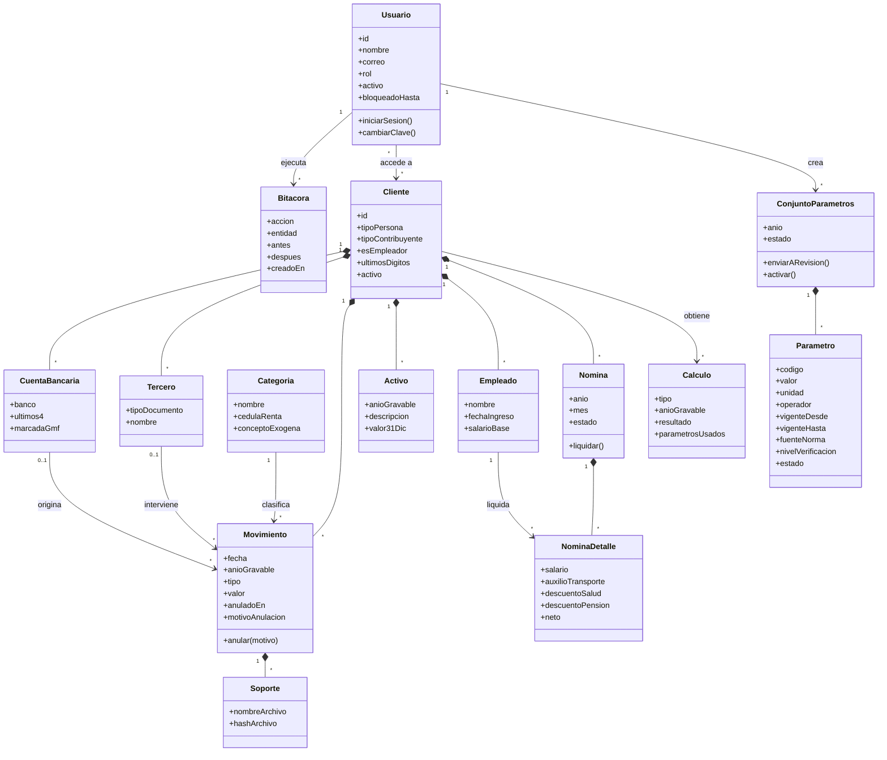
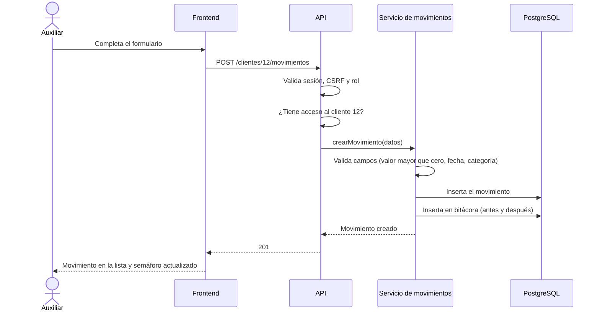
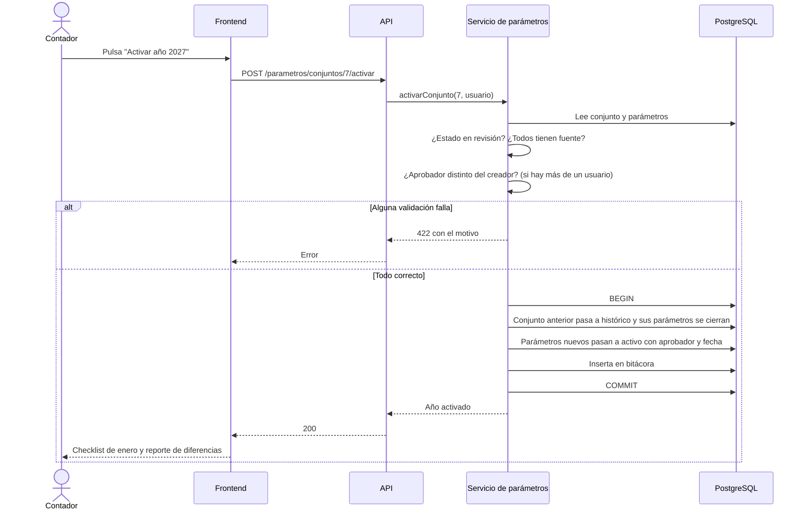
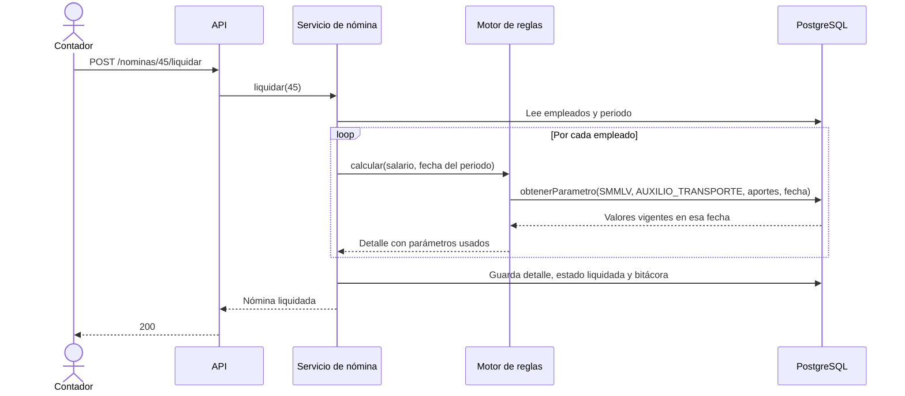
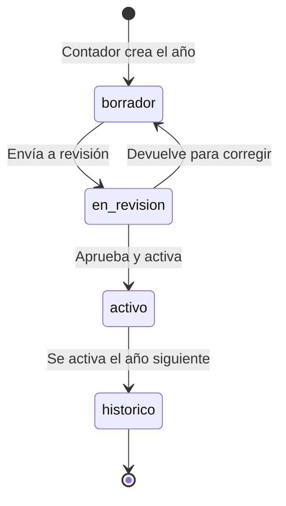
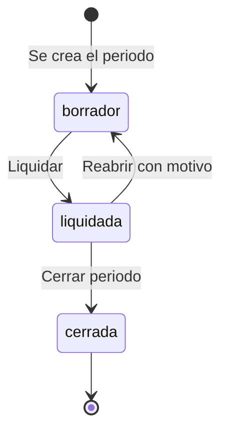
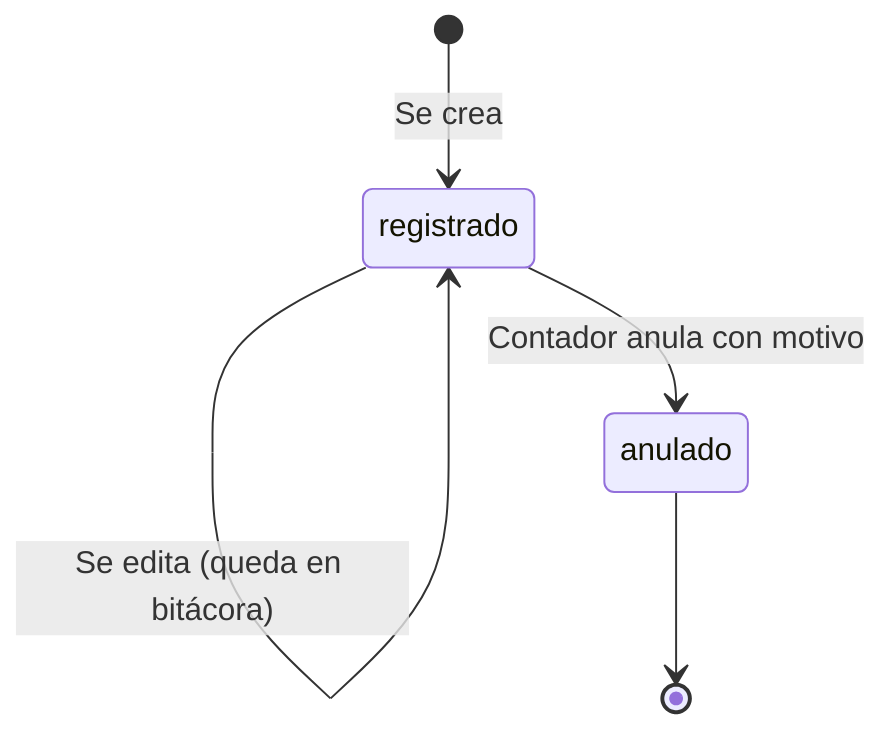
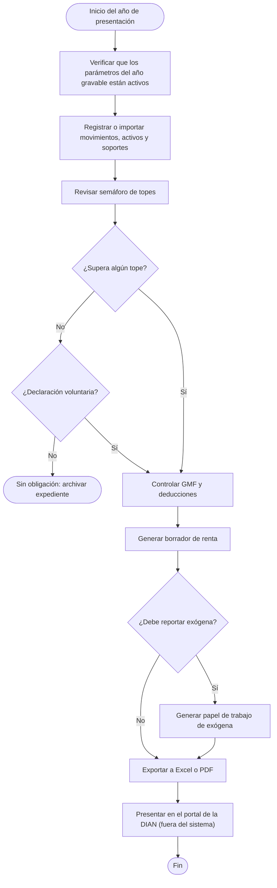

# Diagramas UML

> Versión 0.1 · 17-oct-2026 · Estado: borrador. Diagramas en Mermaid (se ven directo en GitHub). Coherentes con `02-modelo-de-datos.md`, `04-api.md` y las historias de usuario (HU).

## 1. Casos de uso

Mermaid no tiene un diagrama de casos de uso nativo; se representa con actores y casos de uso en un diagrama de flujo. Entre paréntesis, la historia de usuario.

```mermaid
flowchart LR
    CON(["Contador"])
    AUX(["Auxiliar"])
    CLI(["Cliente"])

    subgraph ACC["Acceso"]
        UC1("Iniciar sesión · HU-01")
        UC2("Gestionar usuarios y permisos · HU-02")
    end
    subgraph CLN["Clientes y movimientos"]
        UC3("Registrar cliente · HU-10")
        UC4("Consultar expediente · HU-11")
        UC5("Adjuntar soportes · HU-12")
        UC6("Registrar movimiento · HU-20")
        UC7("Importar extracto · HU-21")
        UC8("Anular movimiento")
    end
    subgraph PAR["Parámetros"]
        UC9("Consultar parámetros vigentes · HU-30")
        UC10("Preparar año nuevo · HU-31")
        UC11("Aprobar y activar año · HU-32")
        UC12("Registrar cambio a mitad de año · HU-33")
    end
    subgraph OBL["Obligaciones y papeles de trabajo"]
        UC13("Ver semáforo de topes · HU-40")
        UC14("Ver obligación de exógena · HU-41")
        UC15("Ver calendario · HU-42")
        UC16("Controlar GMF · HU-50")
        UC17("Generar borrador de renta · HU-60")
        UC18("Generar papel de trabajo de exógena · HU-61")
        UC19("Exportar a Excel o PDF · HU-62")
    end
    subgraph NOM["Nómina"]
        UC20("Liquidar nómina · HU-70")
        UC21("Ver provisiones · HU-71")
    end
    UC22("Consultar bitácora · HU-81")

    CON --- UC1 & UC2 & UC3 & UC4 & UC5 & UC6 & UC7 & UC8
    CON --- UC9 & UC10 & UC11 & UC12
    CON --- UC13 & UC14 & UC15 & UC16 & UC17 & UC18 & UC19
    CON --- UC20 & UC21 & UC22
    AUX --- UC1 & UC4 & UC5 & UC6 & UC7 & UC9 & UC13 & UC16
    CLI --- UC1 & UC5 & UC13 & UC15
```



## 2. Diagrama de clases del dominio

Modelo conceptual (no incluye servicios ni controladores). Los atributos corresponden a las columnas de `02-modelo-de-datos.md`.



## 3. Diagramas de secuencia

### 3.1 Iniciar sesión (HU-01)

```mermaid
sequenceDiagram
    actor U as Usuario
    participant F as Frontend
    participant A as API
    participant DB as PostgreSQL
    U->>F: Correo y contraseña
    F->>A: POST /auth/login
    A->>DB: Busca usuario por correo
    alt Usuario bloqueado
        A-->>F: 429 Demasiados intentos
    else Credenciales válidas
        A->>DB: Reinicia intentos fallidos
        A->>DB: Registra inicio de sesión en bitácora
        A-->>F: 200 y cookie httpOnly
    else Credenciales inválidas
        A->>DB: Suma intento fallido; bloquea si corresponde
        A-->>F: 401 "Credenciales inválidas"
    end
```

### 3.2 Registrar un movimiento (HU-20)



### 3.3 Activar el año nuevo (HU-32)



### 3.4 Liquidar una nómina (HU-70)



## 4. Diagramas de estados

### 4.1 Conjunto de parámetros de un año



### 4.2 Nómina



### 4.3 Movimiento



## 5. Diagrama de actividad: temporada de renta de un cliente



## 6. Trazabilidad

| Diagrama | Historias y requisitos |
|---|---|
| Casos de uso | HU-01 a HU-81 |
| Clases | `02-modelo-de-datos.md`, RF-10 a RF-63 |
| Secuencia 3.1 | HU-01, RNF-01 |
| Secuencia 3.2 | HU-20, RF-04, RNF-03 |
| Secuencia 3.3 | HU-32, RF-32, RF-33, RN-61, RN-62 |
| Secuencia 3.4 | HU-70, RF-63, RN-01 |
| Estados | RF-31, RF-32, RF-33, RF-61, ADR-011 |
| Actividad | HU-40, HU-50, HU-60, HU-61, RN-10 a RN-16 |
