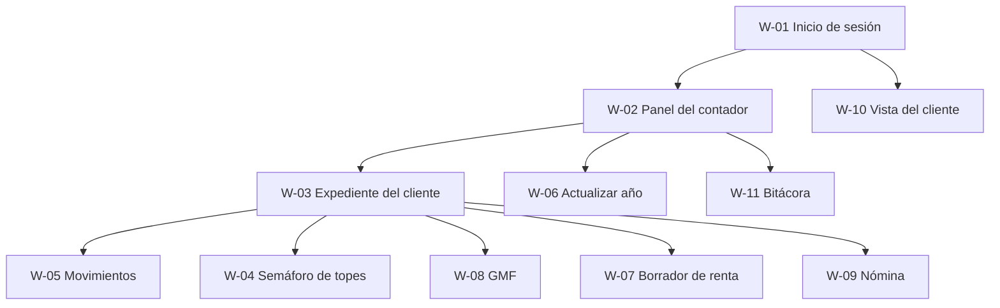

# Wireframes

> Versión 0.1 · 17-oct-2026 · Estado: borrador de baja fidelidad. Bocetos en texto para acordar la estructura de las pantallas antes de programarlas. El diseño visual final (colores, tipografía) se define en el frontend con Tailwind.
> Todas las cifras y nombres son **ficticios**.

## 1. Principios de interfaz

| Principio | Aplicación |
|---|---|
| El estado nunca depende solo del color | El semáforo muestra color, icono y texto ("En rango", "Atención", "Superado") (RNF-05) |
| Cada cifra explica su origen | Un icono "ⓘ" abre el parámetro y su fuente (RF-53) |
| El año de trabajo siempre visible | Selector de año gravable en el encabezado |
| Acciones destructivas con confirmación y motivo | Anular movimiento, desactivar cliente |
| Formularios accesibles | Etiquetas asociadas, foco visible, errores junto al campo |
| Modo claro y oscuro | RNF-05 |
| Adaptable a pantallas pequeñas | Tablas con desplazamiento horizontal; menú colapsable |

## 2. Mapa de navegación



## 3. Pantallas

### W-01 · Inicio de sesión (HU-01)

```
┌────────────────────────────────────────┐
│               ContaNegocios            │
│                                        │
│   Correo                               │
│   ┌──────────────────────────────┐     │
│   │                              │     │
│   └──────────────────────────────┘     │
│   Contraseña                           │
│   ┌──────────────────────────────┐     │
│   │ ••••••••                     │     │
│   └──────────────────────────────┘     │
│                                        │
│   [ Iniciar sesión ]                   │
│                                        │
│   Mensaje de error: "Credenciales      │
│   inválidas"                           │
└────────────────────────────────────────┘
```

### W-02 · Panel del contador

```
┌─────────────────────────────────────────────────────────────────────┐
│ ContaNegocios      Año gravable: [2025 ▾]            Danny ▾  [Salir]│
├──────────┬──────────────────────────────────────────────────────────┤
│ Clientes │  ⚠ Faltan los parámetros del año 2027        [Preparar]  │
│ Parámetros│                                                          │
│ Calendario│  Buscar cliente: [______________]   [+ Nuevo cliente]    │
│ Bitácora │                                                          │
│ Usuarios │  Cliente           Tipo        Estado de topes   Próximo │
│          │                                                   vencim. │
│          │  Ana Pérez (demo)  Asalariado  ● Superado        26-oct  │
│          │  Luis Gómez (demo) Otro        ◐ Atención 84%    26-oct  │
│          │  Marta Ruiz (demo) Empleador   ○ En rango 31%    —       │
│          │                                                          │
│          │  Pág. 1 de 1                                             │
└──────────┴──────────────────────────────────────────────────────────┘
```

### W-03 · Expediente del cliente (HU-11)

```
┌─────────────────────────────────────────────────────────────────────┐
│ ← Clientes     Luis Gómez (demo)          Año gravable: [2025 ▾]    │
│ CC ••••4521 · Contribuyente: Otro · No es empleador                 │
├─────────────────────────────────────────────────────────────────────┤
│ [Resumen] Movimientos  Activos  Obligaciones  Renta  Exógena  GMF   │
│ Nómina  Soportes                                                    │
├─────────────────────────────────────────────────────────────────────┤
│  Ingresos del año      Gastos del año       Consignaciones          │
│  $ 58.400.000          $ 21.150.000         $ 40.000.000            │
│                                                                     │
│  Obligaciones (resumen)                                             │
│  ◐ Renta: 1 tope en atención        ○ Exógena: no obligado          │
│  Próximo vencimiento: 26-oct-2026                                   │
│                                                                     │
│  Pendientes                                                         │
│  • 3 movimientos sin categoría      • 2 soportes por adjuntar       │
└─────────────────────────────────────────────────────────────────────┘
```

### W-04 · Semáforo de topes (HU-40)

```
┌─────────────────────────────────────────────────────────────────────┐
│ Topes para declarar renta · Año gravable 2025                       │
│ UVT 2025: $ 49.799 ⓘ                                                │
├───────────────────────┬────────────┬────────────┬──────┬────────────┤
│ Tope                  │ Acumulado  │ Límite     │ %    │ Estado     │
├───────────────────────┼────────────┼────────────┼──────┼────────────┤
│ Ingresos brutos ⓘ     │ 58.400.000 │ 69.718.600 │ 84%  │ ◐ Atención │
│ Patrimonio bruto ⓘ    │ 96.000.000 │224.095.500 │ 43%  │ ○ En rango │
│ Consumos con tarjeta ⓘ│ 12.300.000 │ 69.718.600 │ 18%  │ ○ En rango │
│ Compras y consumos ⓘ  │ 31.000.000 │ 69.718.600 │ 44%  │ ○ En rango │
│ Consignaciones ⓘ      │ 40.000.000 │ 69.718.600 │ 57%  │ ○ En rango │
└───────────────────────┴────────────┴────────────┴──────┴────────────┘
 ⓘ Al pulsar: regla aplicada, parámetro usado, fuente y nivel de
   verificación (✅ ⚠️ ❓).
 Leyenda: ○ En rango (<70%)  ◐ Atención (70–99%)  ● Superado (≥100%)
 Calculado el 17-oct-2026 14:30        [Recalcular]  [Exportar]
```

### W-05 · Movimientos (HU-20)

```
┌─────────────────────────────────────────────────────────────────────┐
│ Movimientos · Luis Gómez (demo)                                     │
│ Filtros: Tipo [Todos ▾]  Desde [____]  Hasta [____]  Cat. [Todas ▾] │
│                                         [+ Registrar] [Importar]    │
├────────────┬───────────┬──────────────┬────────────┬────────┬───────┤
│ Fecha      │ Tipo      │ Categoría    │ Valor      │Soporte │ Acc.  │
├────────────┼───────────┼──────────────┼────────────┼────────┼───────┤
│ 2025-03-14 │ Ingreso   │ Honorarios   │ 4.200.000  │ 📎 1   │ ✎ ⊘   │
│ 2025-03-15 │ Gasto     │ Arriendo     │ 1.500.000  │ —      │ ✎ ⊘   │
│ 2025-03-20 │ GMF       │ 4x1000       │    16.800  │ —      │ ✎ ⊘   │
└────────────┴───────────┴──────────────┴────────────┴────────┴───────┘
 ✎ editar   ⊘ anular (pide motivo; solo contador)

 ── Formulario "Registrar movimiento" ──────────────────────────────
 Fecha [__/__/____]   Tipo [Ingreso ▾]   Valor [__________]
 Categoría [Seleccione ▾]   Tercero [Seleccione ▾]   Cuenta [Seleccione ▾]
 Descripción [______________________________________]
 Soporte [Elegir archivo]  (PDF, PNG o JPG)
                                           [Cancelar]  [Guardar]
```

### W-06 · Actualizar año (HU-31, HU-32)

```
┌─────────────────────────────────────────────────────────────────────┐
│ Actualizar parámetros · Año 2027                  Estado: Borrador  │
│ Paso:  ① Preparar ─ ② Cargar ─ ③ Revisar ─ ④ Activar                │
├─────────────────────────────────────────────────────────────────────┤
│ ② Cargar valores                                                    │
│ Código               Valor 2026   Valor 2027   Fuente (obligatoria) │
│ UVT                  52.374       [_________]  [__________________] │
│ SMMLV                1.750.905    [_________]  [__________________] │
│ AUXILIO_TRANSPORTE   249.095      [_________]  [__________________] │
│ RENTA_TOPE_INGRESOS  1.400 UVT    [_________]  [__________________] │
│ …                                                                   │
│ Nivel de verificación: [✅ ▾]   Vigente desde: [01/01/2027]         │
│                                        [Guardar borrador] [Siguiente]│
├─────────────────────────────────────────────────────────────────────┤
│ ③ Revisar: reporte de diferencias                                   │
│ SMMLV: 1.750.905 → 1.8xx.xxx   (+x,x %)                              │
│ Checklist de enero:  ☐ UVT  ☐ Salario mínimo y auxilio              │
│ ☐ Topes de renta y exógena  ☐ Calendario  ☐ Formatos exógena         │
│ ☐ Aportes y prestaciones  ☐ Tarifas de renta                         │
├─────────────────────────────────────────────────────────────────────┤
│ ④ Activar                                                           │
│ Vigencia: 01/01/2027. Los parámetros de 2026 pasan a histórico.      │
│                              [Volver]            [Activar año 2027]  │
└─────────────────────────────────────────────────────────────────────┘
```

*Los valores 2027 aparecen como marcadores `x`: no se conocen y no deben inventarse.*

### W-07 · Borrador de renta (HU-60)

```
┌─────────────────────────────────────────────────────────────────────┐
│ Borrador de renta · Año gravable 2025 · Luis Gómez (demo)           │
│ Papel de trabajo: no reemplaza el formulario oficial de la DIAN     │
├─────────────────────────────────────────────────────────────────────┤
│ Cédula                      Ingresos          Deducciones           │
│ Rentas de trabajo           —                 —                     │
│ Rentas de capital           2.400.000         —                     │
│ Rentas no laborales         56.000.000        21.150.000            │
│ Otros                       —                 —                     │
│                                                                     │
│ GMF pagado: 168.000    Deducible (50%): 84.000 ⓘ                    │
│                                                                     │
│ Soportes asociados: 14 de 17   ⚠ Faltan 3                           │
├─────────────────────────────────────────────────────────────────────┤
│ Generado: 17-oct-2026 14:32      [Recalcular] [Excel] [PDF]         │
└─────────────────────────────────────────────────────────────────────┘
```

### W-08 · GMF (HU-50)

```
┌─────────────────────────────────────────────────────────────────────┐
│ GMF (4x1000) · Año 2025                                             │
│ Exención mensual: 350 UVT ⓘ                                         │
├──────────┬──────────────┬──────────────┬─────────────┬──────────────┤
│ Mes      │ Retiros      │ Exención     │ GMF pagado  │ Alerta       │
├──────────┼──────────────┼──────────────┼─────────────┼──────────────┤
│ Enero    │ 6.200.000    │ 17.429.650   │ 0           │ —            │
│ Febrero  │ 21.000.000   │ 17.429.650   │ 14.281      │ ⚠ Excede     │
│ …        │              │              │             │              │
└──────────┴──────────────┴──────────────┴─────────────┴──────────────┘
 Cuenta: [Banco demo ••1234 ▾]   Marcada para exención: [Sí/No/No sé]
 Total GMF pagado: 168.000     Deducción en renta (50%): 84.000
```

*(La exención en pesos usa la UVT del año de cada mes; los valores son ficticios.)*

### W-09 · Nómina (HU-70)

```
┌─────────────────────────────────────────────────────────────────────┐
│ Nómina · Marta Ruiz (demo) · Octubre 2026       Estado: Borrador    │
│ Parámetros vigentes al 31-oct-2026: SMMLV ⓘ  Auxilio ⓘ  Aportes ⓘ    │
├────────────┬──────────┬──────────┬──────────┬──────────┬────────────┤
│ Empleado   │ Salario  │ Aux.     │ Salud    │ Pensión  │ Neto       │
│            │          │ transp.  │ (empl.)  │ (empl.)  │            │
├────────────┼──────────┼──────────┼──────────┼──────────┼────────────┤
│ Empleado 1 │ 1.750.905│ 249.095  │ …        │ …        │ …          │
├────────────┴──────────┴──────────┴──────────┴──────────┴────────────┤
│ Total neto: …    Aportes del empleador: …   Provisiones: …          │
│                         [Guardar borrador]  [Liquidar]  [Exportar]   │
└─────────────────────────────────────────────────────────────────────┘
```

### W-10 · Vista del cliente (HU-80)

```
┌─────────────────────────────────────────────────────────────────────┐
│ ContaNegocios                    Hola, Luis (demo)        [Salir]   │
├─────────────────────────────────────────────────────────────────────┤
│ Año gravable [2025 ▾]                                               │
│ Tu resumen                                                          │
│  Ingresos: $ 58.400.000     Gastos: $ 21.150.000                    │
│                                                                     │
│ Tus topes                                                           │
│  Ingresos brutos         ◐ Atención 84%                             │
│  Patrimonio bruto        ○ En rango 43%                             │
│  …                                                                  │
│ Próximo vencimiento: 26-oct-2026                                    │
│                                                                     │
│ Soportes                                      [Subir un soporte]    │
│  Certificado bancario.pdf   2025-03-14                              │
│ (Solo lectura: tu contador registra los movimientos)                │
└─────────────────────────────────────────────────────────────────────┘
```

### W-11 · Bitácora (HU-81)

```
┌─────────────────────────────────────────────────────────────────────┐
│ Bitácora · Filtros: Usuario [Todos ▾] Entidad [Parámetros ▾]        │
│ Desde [____]  Hasta [____]                           [Buscar]       │
├──────────────────┬─────────┬────────────────┬───────────────────────┤
│ Fecha y hora     │ Usuario │ Acción         │ Entidad               │
├──────────────────┼─────────┼────────────────┼───────────────────────┤
│ 17-oct-2026 14:30│ Danny   │ Activar año    │ Conjunto 2027         │
│ 17-oct-2026 14:12│ Danny   │ Editar         │ Parámetro SMMLV (2027)│
└──────────────────┴─────────┴────────────────┴───────────────────────┘
 Al abrir una fila: valor anterior y valor nuevo. Solo lectura.
```

## 4. Estados que debe cubrir cada pantalla

| Estado | Qué se muestra |
|---|---|
| Cargando | Indicador de carga con texto, sin bloquear la navegación |
| Vacío | Mensaje con la acción siguiente ("Aún no hay movimientos: registra el primero") |
| Error | Mensaje claro y reintento; sin detalles técnicos |
| Sin permiso | Respuesta del backend; el menú ya oculta lo que el rol no usa |
| Sin parámetros vigentes | Aviso con enlace a "Actualizar año" (código `PARAMETRO_FALTANTE`) |

## 5. Trazabilidad

| Pantalla | Historias y requisitos |
|---|---|
| W-01 | HU-01, RF-01 |
| W-02, W-03 | HU-10, HU-11, RF-35 |
| W-04 | HU-40, RF-40, RF-53 |
| W-05 | HU-12, HU-20, RF-20 a RF-22 |
| W-06 | HU-31, HU-32, RF-31 a RF-36 |
| W-07 | HU-60, HU-62, RF-50, RF-52 |
| W-08 | HU-50, RF-42 |
| W-09 | HU-70, HU-71, RF-60 a RF-63 |
| W-10 | HU-80 |
| W-11 | HU-81, RF-04 |
