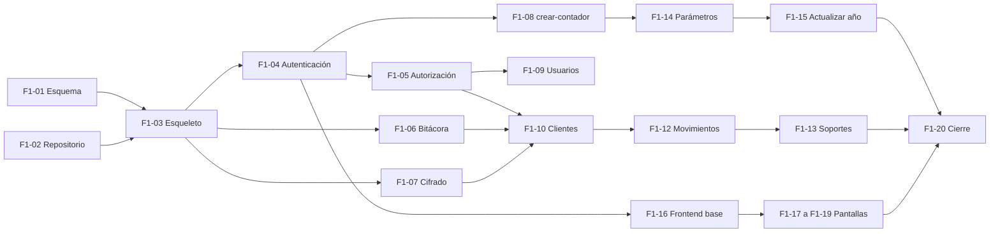

# Plan de la fase F1 · Núcleo

> Versión 0.1 · 17-oct-2026 · Fase F1 de la visión: autenticación y roles, clientes, movimientos, parámetros por año y bitácora. **Cierra cuando se puede registrar un año completo de un cliente.**

## 1. Alcance de F1

| Entra | Historias | Requisitos |
|---|---|---|
| Inicio de sesión y roles | HU-01, HU-02 | RF-01 a RF-03 |
| Clientes, cuentas, terceros y activos | HU-10, HU-11 | RF-10, RF-11 |
| Movimientos y soportes | HU-12, HU-20 | RF-20, RF-21 |
| Consulta de parámetros vigentes y actualización anual | HU-30 a HU-33 | RF-30 a RF-36 |
| Bitácora | HU-81 | RF-04 |

No entra (fases posteriores): semáforo, GMF, calendario (F2); renta y exógena (F3); nómina (F4); importación (F5).

## 2. Tareas

Tamaño: **S** pequeña, **M** mediana, **L** grande. Cada tarea es una tarjeta de Trello y una rama.

| ID | Tarea | Tam. | Depende de | Hecho cuando |
|---|---|---|---|---|
| F1-01 | Esquema de la base de datos y permisos (`schema.sql`, `permisos.sql`) | S | — | Se crean las 12 tablas y las restricciones responden como en los casos CP-12, CP-17, CP-48 |
| F1-02 | Estructura del repositorio: `.gitignore`, `.env.example`, carpetas | S | — | El repositorio no incluye secretos |
| F1-03 | Esqueleto del backend: servidor, conexión a la base, configuración, manejo de errores, `GET /salud` | M | F1-01, F1-02 | `GET /api/v1/salud` responde |
| F1-04 | Autenticación: login, logout, `me`, token CSRF, cambio de clave, bloqueo por intentos | L | F1-03 | CP-01 a CP-04, PS-01, PS-07 a PS-09 |
| F1-05 | Autorización: roles y pertenencia al cliente (404 a recursos ajenos) | M | F1-04 | CP-05 a CP-07, PS-02 a PS-04 |
| F1-06 | Servicio de bitácora (solo inserción) | S | F1-03 | CP-47, CP-48 |
| F1-07 | Cifrado de campos (documento y cuenta) y hash de búsqueda | M | F1-03 | CP-10, PS-12 |
| F1-08 | Script `crear-contador` | S | F1-04 | Se crea el primer contador con la clave guardada solo como hash |
| F1-09 | Usuarios y accesos a clientes | M | F1-05 | HU-02 |
| F1-10 | Clientes, cuentas bancarias, terceros y activos | L | F1-05, F1-06, F1-07 | CP-08, CP-09 |
| F1-11 | Categorías (catálogo inicial) | S | F1-03 | `GET /categorias` devuelve el catálogo |
| F1-12 | Movimientos: crear, listar, editar, anular | L | F1-10, F1-11 | CP-11 a CP-15 |
| F1-13 | Soportes: subir y descargar con validación | M | F1-12 | PS-10, PS-11 |
| F1-14 | Parámetros: consulta por fecha y semilla de 2025 y 2026 | M | F1-08 | CP-16, CP-23 |
| F1-15 | Actualización anual: crear año, editar, revisión, diferencias, activar (transacción), ajustes | L | F1-14, F1-06 | CP-17 a CP-22, CP-24, CP-52 |
| F1-16 | Frontend: estructura, inicio de sesión y menú por rol | M | F1-04 | HU-01 |
| F1-17 | Frontend: panel, clientes y expediente | L | F1-16, F1-10 | HU-10, HU-11 |
| F1-18 | Frontend: movimientos y soportes | L | F1-17, F1-12 | HU-12, HU-20 |
| F1-19 | Frontend: parámetros y "Actualizar año" | L | F1-16, F1-15 | HU-30 a HU-33 |
| F1-20 | Pruebas de cierre de F1 y actualización de la documentación | M | todas | Todos los casos críticos y altos de F1 aprobados |

## 3. Orden propuesto

Primero el **backend completo con pruebas** y después el frontend, para que cada pantalla se construya sobre una API ya probada.

## 4. Riesgos de F1

| Riesgo | Mitigación |
|---|---|
| El primer inicio de sesión se vuelve largo y bloquea todo | F1-04 se divide en ramas pequeñas: login, bloqueo, CSRF, cambio de clave |
| Errores de dinero por usar números flotantes | ADR-004; pruebas con cifras calculadas a mano |
| La clave de cifrado se pierde | Guardarla aparte desde el primer día (`05-despliegue/02-respaldo-y-restauracion.md`) |
| Alcance que crece | Todo lo que no esté en la tabla va al Backlog |

## 5. Entregable de cierre

- Backend y frontend de F1 funcionando en local.
- Casos de prueba críticos y altos de F1 aprobados, con evidencia.
- Un cliente demo con un año completo de movimientos registrado.
- Año 2026 de parámetros activado desde la pantalla "Actualizar año".
- Documentación actualizada y tarjetas en **Hecho**.
